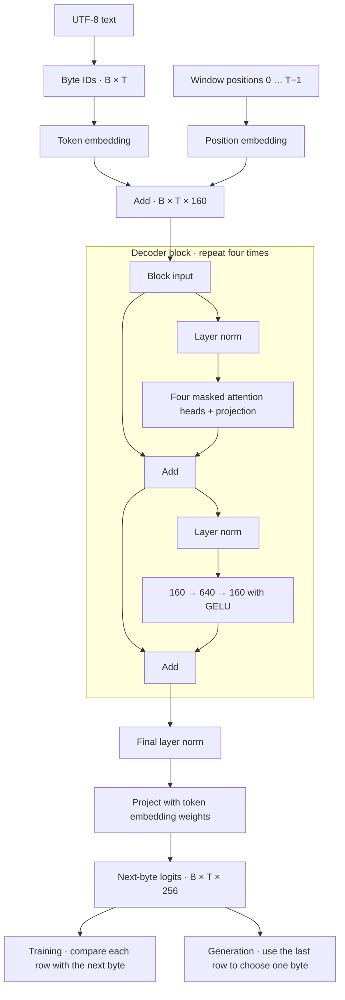

# A byte through MiniGPT

Trace the prompt `Ali`. The UTF-8 tokenizer gives it the IDs `[65, 108, 105]`. At training time this span can supply two predictions. After `A`, the target is `l`. After `Al`, the target is `i`. At generation time the model receives all three IDs and predicts the byte after `Ali`. Each prediction gives a score to every possible next byte.

## From text to logits

Here `B` counts sequences in a batch and `T` counts bytes in a sequence. The default model permits `T ≤ 128`. Each hidden vector has `D = 160` features. Each of the `H = 4` heads uses `d = D/H = 40` features. [Model implementation](../minigpt/model.py)

### 1. Encode a chapter and draw a batch

`ByteTokenizer.encode` stores each UTF-8 byte as an integer in `0…255`. Its vocabulary is fixed, so it needs no fitting. `é` encodes as `[195, 169]`, which uses two places in the context. Decoding an encoded string recovers its original Unicode text. Independently generated bytes can form invalid UTF-8 sequences. The interface renders those sequences using the replacement character `�`. [Tokenizer](../minigpt/tokenizer.py)

`Corpus` verifies each chapter against a checksum and assigns it to its predefined split. To create an input of length `T`, the sampler takes `T+1` consecutive bytes from a single chapter. It returns the first `T` as `x` and the last `T` as `y`. Every valid starting offset in the training split has equal probability. Sampling with replacement permits overlapping windows and repeated passages. [Batch sampler](../minigpt/data.py) · [Source, rights and preprocessing](DATA.md)

### 2. Give each byte an identity and a position

The embedding table $E$ holds one learned row per byte. The position table $P$ holds one learned row per position in a window. Position $t$ begins with $h_t=E[x_t]+P[t]$. The sum gives the attention layer both kinds of information at the same feature width. Learned positions make the implementation easy to inspect and set a fixed upper limit on each forward pass. Both tables start with random weights. [Model implementation](../minigpt/model.py)

### 3. Mix information across earlier positions

A learned linear transformation produces queries, keys and values from the normalized hidden vectors. MiniGPT computes all three together in `qkv`, then reshapes them into separate heads. Each head compares its query at position $i$ with keys at all visible positions $j$.

$$
s_{ij}=\frac{q_i\cdot k_j}{\sqrt{d}},\qquad
a_{ij}=\frac{\exp(s_{ij})}{\sum_{r=0}^{i}\exp(s_{ir})}\ (j\le i),\qquad
z_i=\sum_{j=0}^{i}a_{ij}v_j.
$$

Dividing by $\sqrt d$ controls the scale of dot products as head width grows. The implementation fills scores above the matrix diagonal with $-\infty$ before softmax, which gives future positions zero probability. This lets training compute predictions across a whole window in parallel without revealing later targets. Concatenating the heads and applying a learned projection mixes their outputs. [Attention and mask](../minigpt/model.py) · [Prefix-invariance and exact mask tests](../tests/test_model.py) · [Vaswani et al., *Attention Is All You Need*](https://arxiv.org/abs/1706.03762)

### 4. Update each position through a residual block

Layer normalization computes the mean $\mu$ and variance $\sigma^2$ over the features of **one token**. Its learned scale and shift each have $D$ components.

$$
\operatorname{LN}(h)=\gamma\odot\frac{h-\mu}{\sqrt{\sigma^2+10^{-5}}}+\beta.
$$

Each block applies normalization before each branch. With dropout at its default of zero, the update is

$$
u=h+\operatorname{Attention}(\operatorname{LN}_1(h)),\qquad
h'=u+\operatorname{MLP}(\operatorname{LN}_2(u)).
$$

The additions give the gradient a direct path through each block. The MLP operates on each position independently. It expands 160 features to 640, applies GELU, then projects back to 160. GELU maps a value $x$ to $x\Phi(x)$, where $\Phi$ is the standard normal cumulative distribution function. Four blocks allow repeated attention and feature transformations while keeping the model small enough for the local experiment. [Decoder block](../minigpt/model.py)

### 5. Predict the next byte and update the weights

After final normalization, the model computes $Z=h_{\mathrm{final}}E^\top$. This reuses the input embedding table as the output classifier. Sharing removes a second $256\times160$ matrix. The output shape is $B\times T\times256$. Each element $Z_{btv}$ is a logit for candidate byte $v$.

$$
p_{btv}=\frac{\exp(Z_{btv})}{\sum_{j=0}^{255}\exp(Z_{btj})},\qquad
\mathcal L=-\frac{1}{N}\sum_{b,t\;\mathrm{scored}}\log p_{bt,y_{bt}}.
$$

`next_token_loss` passes raw logits to PyTorch cross-entropy, which computes the log-softmax stably. In a training batch $N=BT$. Calling `backward()` accumulates a gradient for each learned weight. The engine clips the global gradient norm to 1 and applies AdamW. AdamW keeps moving averages of each gradient and its square to scale updates and applies decoupled weight decay to the parameters. The implementation uses a constant learning rate and decay coefficient 0.01. [Training engine](../minigpt/engine.py) · [Training command](../minigpt/train.py) · [Loshchilov and Hutter, *Decoupled Weight Decay Regularization*](https://arxiv.org/abs/1711.05101)

## How big is this model?

| Learned component | Parameters |
| --- | ---: |
| Byte embeddings, shared with output | 40,960 |
| Absolute position embeddings | 20,480 |
| One block's attention, including biases | 103,040 |
| One block's MLP, including biases | 205,600 |
| One block's two layer norms | 640 |
| Final layer norm | 320 |

The four blocks contribute $4\times309{,}280$ parameters, for a total of **1,298,880**. The weights alone use about 4.95 MiB in float32. Weights, gradients and AdamW's two moment tensors together account for about 19.82 MiB. Intermediate tensors, working buffers and the PyTorch and Metal runtimes require additional memory. On Apple Silicon, process and GPU allocations share physical RAM, so adding their reported counters can double-count memory. [Architecture tests](../tests/test_model.py) · [Memory preflight](../minigpt/diagnostics.py)

For $L$ blocks and vocabulary size $V$, a forward pass takes on the order of

$$
LBTD^2 + LBT^2D + BTDV
$$

operations. The three terms cover dense projections and the MLP, attention across positions, and vocabulary projection. Backpropagation has the same asymptotic cost with extra work to compute gradients. This implementation materializes a score matrix of shape $B\times H\times T\times T$ in each block. For $B=8$, $H=4$, $T=128$, one such float32 matrix occupies 2 MiB. Doubling the context quadruples the size of that matrix. Doubling the model width roughly quadruples the weight count of the block's dense layers.

## How to read an experiment

1. **Smoke test.** A real text batch goes through one optimizer update, checkpoint reload and generation. **Fixed-batch overfitting** then checks whether a small network can memorize the same 64 targets. This isolates the learning path from generalization. [Diagnostics](../minigpt/diagnostics.py)
2. **Fit and resume.** A disposable four-step preflight measures memory at the selected shape. A fresh fit starts from newly seeded weights. Checkpoints store weights, optimizer moments, step, configuration, corpus fingerprint and random states. Separate random generators control batch selection and text sampling. The training loop saves progress periodically and at its stopping point. [Training command](../minigpt/train.py) · [Checkpoint tests](../tests/test_engine.py)
3. **Score held-out chapters.** Evaluation counts each within-chapter prediction once. It resets context at the beginning of each chunk and excludes padded targets from the denominator. Loss is the summed negative log-likelihood divided by the total number of scored targets. Perplexity is $\exp(\mathcal L)$, the reciprocal geometric mean probability assigned to the true next byte. Uniform probabilities give $\log(256)\approx5.545$ nats per byte and perplexity 256. The train-fitted unigram baseline uses the same byte vocabulary and ignores context. Read the measured scores alongside the generated passages. [Evaluator](../minigpt/evaluate.py) · [Model card](MODEL_CARD.md)

## Generation and the local interface

Generation starts with a nonempty prompt. At each step it keeps the last 128 bytes under the default configuration, resets positions to start at zero and runs the model. Only the final position's logits are needed for the next byte. With positive temperature $\tau$ the sampler uses probabilities proportional to $\exp(Z_v/\tau)$ among the top $k$ candidates. Lower temperatures concentrate probability on the largest logits. At temperature zero the code selects the highest-scoring byte directly. A dedicated CPU generator controls random draws. Repeatability depends on the weights, device, software, seed, prompt and sampling controls. [Sampling loop](../minigpt/generation.py) · [Generation CLI](../minigpt/generate.py)

The loop appends each sampled byte and repeats until the length limit. There is no end-of-text token in the fixed byte vocabulary. It recomputes each context window, which keeps the algorithm small but costs a full forward pass per new byte once the context fills. The chat-style Streamlit screen displays earlier messages while sending each new prompt as an independent continuation. Ten training chapters supply a narrow sample of English, and this training objective rewards predicting book text. The model may echo passages or produce incoherent output. [Streamlit app](../app.py) · [Model card](MODEL_CARD.md)

## Three checks to try

1. Take the text `Tea!` and write the input and target ID sequences for one training window of length three. Encode each character with `ord` to check your answer. Then explain which three attention positions the model can see while predicting `!`.
2. In `test_mask_gives_exact_prefix_averages_in_each_head`, the queries and keys are zero. Predict each row of the attention probabilities for a four-byte sequence, then read how the test checks the output. [Mask test](../tests/test_model.py)
3. Generate from `Alice ` twice with identical settings. Change only the temperature, then only the seed. Observe which changes affect a greedy run and which affect a sampled run. Inspect the held-out byte loss alongside the prose before drawing conclusions about what the model learned. [Generation command](../minigpt/generate.py)
